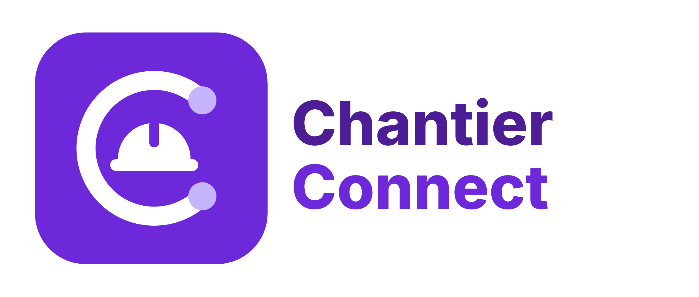

# Chantier Connect



Application mobile Flutter : carnet de notes libre + suivi de chantier (ouvriers, pointage, avancement) + stock par libellés.
Version 0.5 : tout fonctionne **hors ligne** (SQLite sur le téléphone). La synchronisation Supabase viendra ensuite.

## Sous Windows (raccourcis)

- `lancer.bat` : installe les dépendances, lance `flutter analyze` et `flutter test`, puis l'application.
- `demarrer.bat` : connecte LDPlayer ou un téléphone en USB et lance l'application.
- `construire_apk.bat` : produit `ChantierConnect-test.apk` (signé avec la clé de test, pour essai uniquement).

## Démarrer dans VS Code (première fois)

Ouvrir un terminal dans ce dossier (`Terminal > Nouveau terminal`) puis :

```powershell
flutter create --platforms=android,ios --org com.carnetchantier --project-name carnet_chantier .
flutter pub get
flutter test
flutter run
```

- `flutter create .` génère seulement les dossiers `android/` et `ios/` ; il ne touche pas aux fichiers existants de `lib/` et `test/`.
- Pour `flutter run`, branchez un téléphone Android (débogage USB) ou lancez un émulateur
  (`Ctrl+Shift+P` > *Flutter: Launch Emulator*), puis choisissez-le en bas à droite de VS Code.
- F5 lance aussi l'application (VS Code détecte lib/main.dart tout seul).

## Nouveautés 0.5 : compte rendu rédigé par l'IA Gemini

- **Réglage** : icône ✦ en haut de l'accueil → coller une clé API Gemini (gratuite sur aistudio.google.com),
  choisir le modèle (par défaut `gemini-3.8-flash`), « Tester la connexion ».
- **Utilisation** : au moment de créer un rapport PDF (journalier ou hebdomadaire), laisser coché
  « Compte rendu rédigé par l'IA ». Gemini rédige à partir des notes, du journal, des présences, du matériel et des tâches :
  résumé, travaux réalisés, main-d'œuvre, matériel, points d'attention, prochaines étapes.
- **Relecture** : le texte s'ouvre dans un écran modifiable (bouton « Régénérer ») ; le PDF n'est créé qu'après validation.
  Il est placé en tête du rapport, avec la mention qu'il a été rédigé avec l'aide de l'IA.
- **Hors ligne ou sans clé** : le rapport se crée comme avant, sans compte rendu IA.
- **Confidentialité** : seules les données texte de la période sont envoyées à Google ; les photos ne le sont pas.
- Clé possible à la compilation (sans saisie dans l'app) : `flutter build apk --dart-define=GEMINI_API_KEY=...`

Code : `lib/services/gemini.dart` (appel API, consignes, lecture de la réponse ; testé dans `test/gemini_test.dart`),
`lib/screens/reglages_ia_screen.dart`, `lib/screens/compte_rendu_screen.dart`.

## Nouveautés 0.4 : rapports journalier et hebdomadaire

Le rapport PDF se fait à partir des notes et du journal, pour **un jour** ou pour **une semaine** (du lundi au dimanche) :

- **Où** : icône PDF de l'écran *Notes* (carnet entier, tous chantiers et notes libres), icône PDF de la fiche d'un chantier,
  ou bouton « Rapport PDF du journal » dans l'onglet *Journal* du chantier.
- **Contenu** : chiffres clés, synthèse tirée des notes (répartition par type + tous les « Points du jour »),
  avancement des tâches, présences (grille L→D sur la semaine avec jours et montants), matériel
  (mouvements du jour, ou totaux entrées/sorties/transferts et stock en fin de semaine), rappels des 7 jours suivants,
  puis le journal détaillé jour par jour avec les photos.
- Le PDF s'ouvre dans le menu de partage (WhatsApp, e-mail…).

Le calcul est dans `lib/services/rapport_donnees.dart` (testé dans `test/rapport_test.dart`), la mise en page dans `lib/services/rapport.dart`.

## Nouveautés 0.2

- **Photos dans les notes** : boutons « Photo » (appareil) et « Galerie » dans l'éditeur de note.
  Les photos sont réduites (1600 px) et rangées dans le dossier privé de l'application.
- **Rapport journalier PDF** : dans la fiche d'un chantier, icône PDF en haut à droite → choisir le jour →
  le PDF (avancement, présences et montant, matériel, notes et photos du jour) s'ouvre dans le menu de partage
  pour l'envoyer par WhatsApp, e-mail, etc.

Après avoir récupéré cette version : `flutter pub get` puis relancer l'application (pas de simple *hot reload* :
de nouveaux plugins natifs ont été ajoutés). La base locale passe en version 2 automatiquement, sans perte de données.

### iOS uniquement

Ajouter dans `ios/Runner/Info.plist` (à l'intérieur de `<dict>`) :

```xml
<key>NSCameraUsageDescription</key>
<string>Prendre des photos du chantier pour vos notes.</string>
<key>NSPhotoLibraryUsageDescription</key>
<string>Joindre des photos de la galerie à vos notes.</string>
```

Android ne demande aucune configuration supplémentaire.

## Organisation du code

```
lib/
  main.dart                 démarrage, thème, langue française
  theme.dart                couleurs de la charte violette
  models.dart               Note, Chantier, Tâche, Ouvrier, Pointage, Paiement, Libellé, Mouvement
  data/database.dart        schéma SQLite + libellés de départ (ciment, sable, fer…)
  data/store.dart           toute la logique : stock = somme des mouvements, solde ouvrier, avancement
  data/store_scope.dart     accès au store depuis les écrans
  data/photos.dart          prise de photo / galerie, copie et compression
  services/rapport_donnees.dart  calcul des rapports (jour / semaine, chantier / carnet)
  services/rapport.dart     mise en page PDF + choix jour / semaine + partage
  services/gemini.dart      rédaction du compte rendu par l'IA Gemini
  widgets/common.dart       petits composants (tags, barres, formats FCFA et dates)
  screens/
    home_shell.dart         barre du bas + bouton « + » (Note, Pointage, Entrée, Sortie)
    accueil_screen.dart     tableau de bord du jour
    notes_screen.dart       carnet avec filtres et recherche
    note_edit_screen.dart   écrire / modifier une note (type, chantier, rappel, épingle)
    chantiers_screen.dart   liste + création de chantier
    chantier_detail_screen  onglets Tâches / Journal / Ouvriers / Stock
    ouvriers_screen.dart    fiches ouvriers, affectations, paiements, reste dû
    pointage_screen.dart    pointage P / ½ / A, « Tous présents »
    mouvement_screen.dart   saisie de stock en 3 touches avec les libellés
    stock_screen.dart       stock disponible + historique (glisser pour supprimer)
    libelles_screen.dart    catalogue des libellés (favoris, seuils, archivage)
test/store_test.dart        tests des règles : stock, transferts, solde, avancement
```

## Règles de gestion déjà codées

- Stock jamais saisi : il est recalculé à partir des entrées, sorties et transferts.
- Un ouvrier n'est pointé qu'une fois par jour et par chantier (re-pointer remplace).
- Reste dû = jours pointés × taux journalier − paiements (demi-journée = 0,5).
- Avancement du chantier = moyenne des tâches pondérée.
- Un libellé déjà utilisé n'est pas supprimé mais archivé.
- Alerte quand un matériel passe sous son seuil.

## Étapes suivantes prévues

1. Mémos vocaux et listes à cocher dans les notes.
2. Notifications de rappel (`flutter_local_notifications`).
3. Export Excel des pointages et des mouvements.
4. Comptes et synchronisation Supabase (rôles administrateur / chef de chantier).
